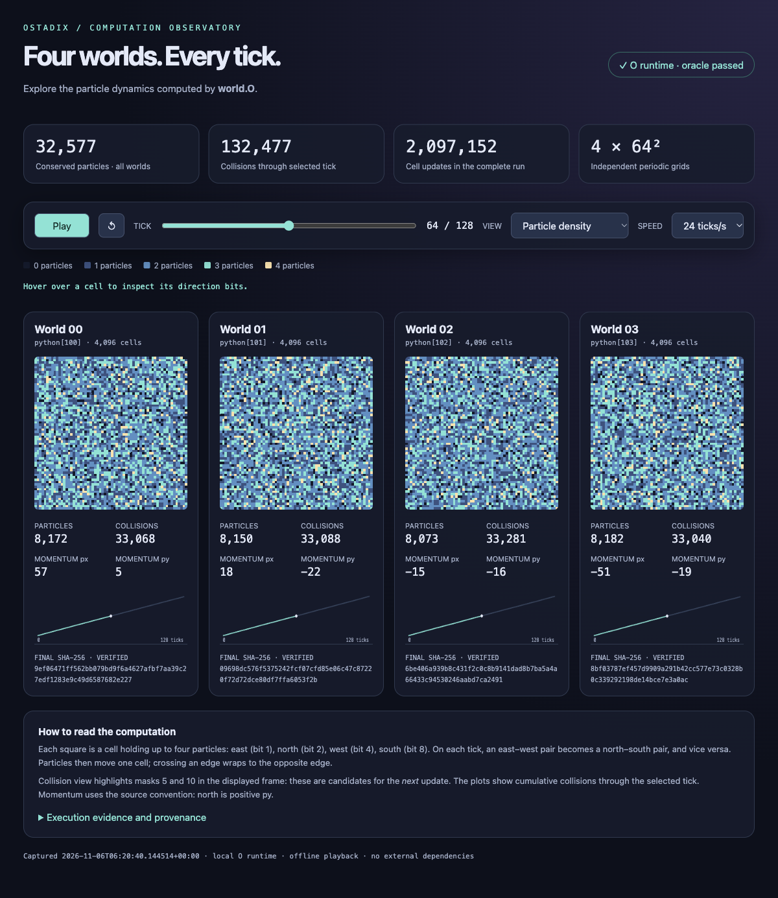

# world.O · Particle observatory

**Four worlds. Every tick.**

I want to see the computation as it happens: where the particles move, when
they collide, and whether the quantities that should stay constant actually do.
This is an offline observatory for `world.O`, an Ostadix program with four
independent particle worlds and an exact result oracle.

The program runs the simulation. The page lets you inspect the recorded states.
Everything needed for playback is embedded in one HTML file.

[](index.html)

<p align="center">
  <a href="#open-it">Open it</a> ·
  <a href="#the-worlds">The worlds</a> ·
  <a href="#reproduce-the-capture">Reproduce</a> ·
  <a href="#check-the-record">Verification</a>
</p>

## Open it

```sh
git clone https://github.com/lostadi/world-visual.git
cd world-visual
```

Open `index.html` in a browser. No installation, CDN, API key, or model is
needed for playback. If you prefer a local server:

```sh
python3 -m http.server 8000 --bind 127.0.0.1
```

Visit `http://127.0.0.1:8000`. The page has no external network dependencies.

| Control | What it shows |
| :--- | :--- |
| **Play / pause** | Recorded evolution from tick 0 through tick 128. |
| **Tick scrubber** | Any one of the 129 saved states per world. |
| **Density** | Number of particles occupying each cell. |
| **Directions** | Each particle's direction bit. |
| **Collision candidates** | Head-on pairs in the displayed state, before the next update. |
| **Cell inspection** | World, coordinates, tick, direction mask, and particle directions. |
| **Execution evidence** | Source fingerprint, result summary, and downloadable capture JSON. |

## The worlds

Each world is a periodic 64 × 64 grid. A cell holds up to four particles,
represented by a four-bit mask:

| Bit | Direction |
| :--- | :--- |
| 1 | East |
| 2 | North |
| 4 | West |
| 8 | South |

An east–west pair scatters into a north–south pair, and vice versa. Particles
then move one cell in their direction. Crossing an edge wraps to the opposite
edge. The program checks conservation of particle count and both components
of momentum.

`world.O` uses four persistent Python evaluator environments, `python[100]`
through `python[103]`, inside one parent Ostadix program. Each world advances
through eight checkpoints. The parent collects their results and computes a
weighted checksum with Python's standard-library SQLite. This example does
not use a separate Ostadix SQL backend.

The complete run contains **2,097,152 cell updates**, **32 checkpoints**, and
**four final SHA-256 hashes**. Playback holds **516 recorded frames** across
the four worlds, containing **32,577 conserved particles** in total.

## Reproduce the capture

Playback needs a browser. Recomputing the data needs a working
[Ostadix](https://github.com/lostadi/OSTADIX) installation and its Python
backend. Run these commands from the repository root, replacing the backend
path with the absolute path for your installation:

```sh
O ./prepare.O /absolute/path/to/OSTADIX/backends
O ./captured-world.O /absolute/path/to/OSTADIX/backends
```

`prepare.O` reads the included `world.O`, records its SHA-256, and instruments
a separate copy. The instrumented program keeps the original update rules
and oracle checks, retains the initial grid and each later state, and writes
`capture.json` and `index.html` after the oracle passes.

The generator expects this source structure and checks its replacement counts.
If you change the simulation, review the instrumentation and oracle together.
It does not modify `world.O`. `WORLD_VISUAL_ROOT` can select a different project
directory; otherwise the generator uses the current working directory.

The `OSTADIX_WASM_MULTIVERSE_PASS` result marker and schema retain their original
names. The publication run used the local hosted evaluator on macOS; that
result is not evidence of a browser WebAssembly execution.

## Check the record

The capture validator needs only Python 3.10 or later. JavaScript syntax
checking uses Node.js:

```sh
python3 verify.py
node --check dashboard.js
```

`verify.py` checks every frame's dimensions and direction masks, particle and
momentum conservation, collision totals, the four expected final hashes, the
source fingerprint, and agreement between the JSON, template, dashboard code,
and generated page.

Verified for this publication on **November 6, 2026**:

- The instrumented Ostadix execution passed its original oracle.
- All 516 captured frames passed the independent capture checks.
- JavaScript syntax passed.
- Browser playback, pause, reset, tick scrubbing, and all three views worked.
- All four grids rendered, with no browser console errors in the checked page.

These checks cover this source and capture. The visualizer replays recorded
computation; it does not rerun the simulation in JavaScript.

## Files

| File | Purpose |
| :--- | :--- |
| [`world.O`](world.O) | Original simulation and result oracle. |
| [`prepare.O`](prepare.O) | Checked capture instrumentation. |
| [`captured-world.O`](captured-world.O) | Generated program used to record the states. |
| [`capture.json`](capture.json) | State history, results, and provenance. |
| [`template.html`](template.html) · [`dashboard.js`](dashboard.js) | Dashboard markup and readable JavaScript source. |
| [`index.html`](index.html) | Self-contained playable capture. |
| [`verify.py`](verify.py) | Capture and publication consistency checks. |

---

By **[Lee Daghlar Ostadi](https://leeostadi.com)**.
No license grant has been added to this source snapshot.
